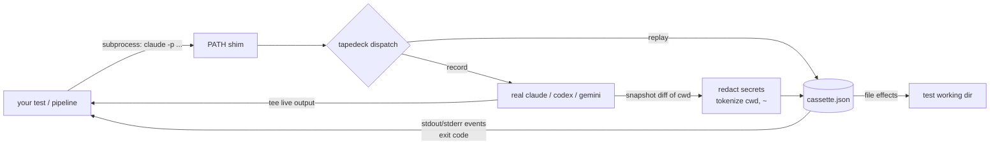

# agent-tapedeck

> **VCR for coding agents.** Record a Claude Code, Codex or Gemini CLI run once (its output,
> its exit code *and every file it wrote*), then replay it in CI in milliseconds, with no API
> key, no network and no flakiness.

  

## Why this exists

If your product shells out to `claude -p`, `codex exec` or `gemini`, your tests have three bad options:

1. **Call the real agent.** Slow (seconds per call), costs tokens, needs a key in CI, and gives a different answer every time.
2. **Mock `subprocess`.** Fast, but your code never sees a real stream-json transcript, and the files the agent would have written don't exist.
3. **Hand-write a fake `claude` binary.** This is what serious agent projects end up doing; one of them ships a 90-line `fake_claude.py` that switches on the system prompt to decide which files to write. It drifts from the real CLI the day you write it.

tapedeck is option 3, done once and generically: a **real transcript** captured from the real CLI, replayed by a shim that sits on `PATH`, plus the **workspace changes** the agent made, re-applied to wherever the test runs.

```
live:    claude -p "..." ............................ 6.5 s, tokens, needs a key, nondeterministic
replay:  claude -p "..."  (tapedeck shim) ........... 0.13 s, $0, no key, identical every run
```

*Measured on this repo's [example](examples/test_agent_pipeline.py): a real Claude Code (haiku) run took 6.47 s to record; the replayed test takes 0.13 s.*

## How it works



* **Shims, not monkeypatching.** tapedeck puts tiny executables named `claude`, `codex`, `gemini` first on `PATH`. Anything that spawns them is intercepted, whether it's your code, a child process or a shell script, in any language.
* **Effects are part of the tape.** Before and after a recorded call, the working directory is snapshotted. Created, changed and deleted files (including the executable bit) are stored and replayed into the *test's* directory just before the final `result` event, exactly when a real run would have finished writing.
* **Portable cassettes.** The recording directory becomes `@@TAPEDECK_CWD@@`, your home becomes `~`, and on replay the live cwd and the live `--session-id` are swapped back in. Record on a laptop, replay on CI.

## Quickstart (30 seconds, no API key)

```bash
uv tool install git+https://github.com/Prime-agentai/agent-tapedeck   # or pip, same Git URL

# Author a fake Claude Code run: final reply + a file it "writes"
tapedeck synth -c demo.json --result '{"status":"ok"}' --write plan.md="# plan"

# Run anything with claude/codex/gemini shimmed onto PATH
tapedeck exec -c demo.json --mode replay -- sh -c 'claude -p "plan it" --output-format stream-json | tail -1; cat plan.md'
```

Then record the real thing (needs the real CLI logged in), and from then on it replays:

```bash
tapedeck exec -c tests/cassettes/pipeline.json --mode once -- pytest -q
```

## pytest

Add it as a dev dependency (`uv add --dev git+https://github.com/Prime-agentai/agent-tapedeck`); the plugin registers itself.

```python
import subprocess, pytest

def test_planner_writes_a_plan(tapedeck, tmp_path):        # cassette: cassettes/<module>/<test>.json
    subprocess.run(["claude", "-p", "write plan.md"], cwd=tmp_path, check=True)
    assert (tmp_path / "plan.md").exists()
    assert tapedeck.calls()[0]["action"] in ("replay", "record")

@pytest.mark.tapedeck("planner.json", fault="hang@1")         # first attempt hangs, retry succeeds
def test_pipeline_retries_a_hung_agent(tapedeck, tmp_path):
    ...
```

```bash
pytest                              # mode "once": record missing cassettes, replay the rest
pytest --tapedeck-mode=replay       # CI: a missing or mismatched cassette fails loudly (exit 97)
pytest --tapedeck-mode=record       # re-record everything against the live agent
```

Marker options: `cassette`, `mode`, `bins`, `fault`, `speed`, `ignore_flags`, `match_on`, `effects`. Cassette directory: the `tapedeck_cassette_dir` ini option (default `cassettes`, next to the test file).

## Python API

```python
from tapedeck import use_cassette

with use_cassette("tests/cassettes/run.json", mode="once", bins=["claude"]) as deck:
    my_pipeline.run()                     # spawns `claude` somewhere deep inside
    print(deck.calls())                   # [{'program': 'claude', 'action': 'replay', ...}]
```

## Features

| | real agent | mock `subprocess` | hand-written fake CLI | **tapedeck** |
|---|:-:|:-:|:-:|:-:|
| Real transcript (stream-json, stderr, exit code) | ✅ | ❌ | ⚠️ hand-made | ✅ recorded |
| Files the agent wrote | ✅ | ❌ | ⚠️ hand-coded | ✅ replayed |
| Deterministic, offline, $0 | ❌ | ✅ | ✅ | ✅ |
| Works across processes and languages | ✅ | ❌ | ✅ | ✅ |
| Failure injection (hang, crash, lying agent) | ❌ | ⚠️ | ⚠️ per project | ✅ built in |
| Secrets kept out of fixtures | n/a | n/a | n/a | ✅ redact + `scan` |
| Drifts from the real CLI | never | always | always | re-record in one flag |

### Modes

| mode | behaviour |
|---|---|
| `once` (default) | cassette missing or empty → record the whole session; otherwise replay |
| `replay` | never touch the real CLI; an unmatched call exits **97** with a diff against the closest recording |
| `record` | start an empty cassette and record every call |
| `new` | replay what matches, record (append) what doesn't |
| `passthrough` | shims step aside and `exec` the real binary |

### Matching

A live call matches a recording when program, argv and stdin are equal **after normalization**: the cwd, `$HOME`, temp dirs, pytest's `pytest-of-*/pytest-N` dirs, `tempfile` names and UUIDs are canonicalized, and the values of volatile flags (`--session-id`, `--resume` by default; `--ignore-flag` / `TAPEDECK_IGNORE_FLAGS` to add more) are ignored. Repeated identical calls replay in recorded order, so retry #2 gets recording #2, then the last one repeats (`TAPEDECK_REPEAT=0` to forbid).

Hand-authored interactions can loosen matching per entry:

```json
"match": {"argv": "any", "stdin": {"contains": "You are the Builder Agent"}}
"match": {"argv": {"regex": "--model (haiku|sonnet)"}, "stdin": "any"}
```

On a miss you get a diff, not a shrug:

```
tapedeck: no recorded interaction matches this claude call (cassette: tests/cassettes/c.json).
--- recorded #0
+++ live call
@@ -1,4 +1,4 @@
 program: claude
 argv: -p
-argv: plan the feature
+argv: plan the features
```

### Faults

Test the unhappy paths that are hard to provoke from a real agent. Set `--fault` / `TAPEDECK_FAULT` / the marker's `fault=`, or bake `"fault"` into a cassette entry. Append `@K` to fire on the K-th call only.

| fault | simulates |
|---|---|
| `hang` | the agent stalls after its first event: does your watchdog fire? |
| `truncate:N` | crash after N events, no files written, exit 1 |
| `exit:N` | full output, then exit code N |
| `delay:S` | slow start (S seconds before the first byte) |
| `drop-effects` | the agent *says* it did the work but wrote nothing: do you verify? |

## CLI

```
tapedeck exec   -c CASSETTE [--mode M] [--bin claude ...] [--fault F] [--speed X] -- CMD ...
tapedeck record -c CASSETTE -- claude -p "..."        # one real call, appended
tapedeck play   -c CASSETTE -- claude -p "..."        # one replayed call
tapedeck ls     CASSETTE                              # table of interactions
tapedeck show   CASSETTE INDEX [--json]               # print a recorded transcript
tapedeck scan   CASSETTE ...                          # exit 1 on credential-shaped strings (pre-commit / CI)
tapedeck synth  -c CASSETTE --result TEXT [--format stream-json|json|text] [--write P=C] [--when-stdin-contains S]
tapedeck shim   --dir DIR [--bin NAME]                # write shims for a custom CI setup
```

`--speed 1` replays at the recorded pace (useful for UI/streaming tests); the default `0` is instant. All settings are also environment variables; see [`.env.example`](.env.example).

## Security model

Cassettes are meant to be committed, so tapedeck treats them as untrusted *and* as potentially leaky:

* **Redaction at record time:** values of env vars named like `*KEY*`, `*TOKEN*`, `*SECRET*`, `*PASSWORD*`, `*AUTH*`, `*CREDENTIAL*`; Anthropic, OpenAI, GitHub, AWS, Google and Slack token shapes; bearer tokens; anything in `TAPEDECK_REDACT`. The live caller still sees real output; only the tape is scrubbed.
* **`tapedeck scan`** re-checks committed cassettes; wire it into pre-commit or CI.
* **Path safety on replay:** effect paths must be relative, may not contain `..`, and may not traverse a symlink out of the working directory. A tampered cassette cannot write outside the test dir.
* **Not covered (be honest with yourself):** PEM key blocks and arbitrary high-entropy strings are not detected. The init event of a Claude transcript lists your MCP servers, plugins and skills; record with `--strict-mcp-config` (as the [example](examples/agent_pipeline.py) does) and read the diff before committing.

## Limitations

* POSIX only (Linux, macOS): shims are `sh` scripts and locking uses `fcntl`.
* Effects are captured under the call's working directory only (skipping `.git`, `node_modules`, `.venv`, caches); writes elsewhere and network/MCP side effects are not recorded. Directories over 20k files skip effect capture with a warning; files over 5 MB are skipped.
* Non-interactive use only: stdin is read to EOF (a silent, never-closed stdin is treated as empty after `TAPEDECK_STDIN_TIMEOUT`, default 2 s). Interactive TTY sessions are out of scope.
* A replay is only as fresh as its recording. Re-record when you change prompts, models or CLI versions.

## Roadmap

- [ ] `tapedeck diff A.json B.json`: semantic diff of two recordings (tools called, files touched, result), to see what changed when a model or CLI version moves
- [ ] Scheduled re-record in CI with a drift report ("the agent stopped calling `Write`")
- [ ] Node/TypeScript test-runner adapters (vitest/jest) on top of the same shims
- [ ] Bidirectional `--input-format stream-json` sessions
- [ ] Windows shims (`.cmd`)
- [ ] PyPI release

## Development

```bash
uv run --with pytest --with mypy ./scripts/check.sh   # compileall + mypy --strict + pytest (replay mode) + cassette scan
```

The suite runs end to end through real subprocesses and real shims. The example was recorded from real Claude Code and replays with no `claude` binary on `PATH` (verified locally on Linux, Python 3.12). A GitHub Actions matrix (Linux + macOS, Python 3.10 to 3.13) is ready in [`ci/github-actions.yml`](ci/github-actions.yml): copy it to `.github/workflows/` in your fork to run it.

## License

MIT. Built by [Prime-agentai](https://github.com/Prime-agentai). The idea of a fake agent CLI as a test fixture is credited to [super-simple-software-factory](https://github.com/disler/super-simple-software-factory)'s `fake_claude.py`; tapedeck generalizes it into recorded, replayable tapes.
